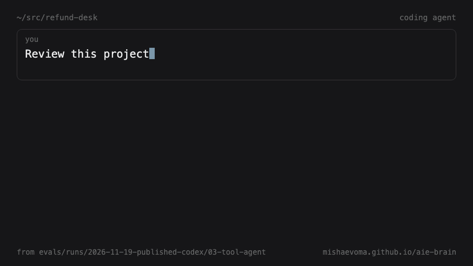

# AI Engineering Brain

A dated, cited wiki of AI engineering practice, compiled into high-signal knowledge your agent can load. It is a compounding, agent-maintained wiki in the Karpathy LLM-wiki pattern: immutable dated sources, cited playbooks, and a freshness linter that flags stale or unbacked claims. Your agent reviews a project against that evidence and returns findings you can verify. A green test run that tested nothing is the kind of miss it catches.

## Get your first review

Open your coding agent **in the project you want reviewed**. With access to your checkout and public Markdown, it can run the review without an install. Paste this into chat.

```text
Review this project using
https://mishaevoma.github.io/aie-brain/review.md
```

The review is read-only. The result appears in the same chat, under your agent’s usual data settings and model usage.

### What comes back



On a small support agent that issues refunds, the review led with this upgrade. Here it is, shortened.

> **Upgrade 1: Make refunds and emails safe to retry.**
>
> **Change.** `agent.py:16` retries every tool the same way, and `tools.py:42` sends the refund with no key. Keep the retry for reads. Give each write one operation ID, and have the payments service drop a repeat.
>
> **Why.** A write can succeed just before the timeout that loses its response, so the retry repeats it. [Side effects and approvals](concepts/side-effects.md) · [Running durable agents, Oct 2026](sources/2026-10-15-vercel-running-durable-agents.md) · [original](https://vercel.com/kb/guide/durable-ai-agents)
>
> **Check.** A fake refund that records the call and then times out is sent 3 times today. After the change it is sent once.
>
> **Evidence.** Published 15 October 2026, 35 days old.
>
> **Effort and impact.** Small to stop the unsafe retry, medium to deduplicate across services. Prevents a customer being refunded twice.

Every upgrade carries those five parts, and a source older than 12 months is labelled as older. You can inspect the evidence, narrow the review (“follow one customer email through a retry”), or reply “make upgrade 1 and run the check.” When nothing needs upgrading, the review says so.

The review is tested on seven sample projects. One has planted issues and one has no AI at all. [See the latest scorecard](evals/scorecard.md)

Some agents cannot read the review URL with their web tool: Codex fails to open the site, and Claude Code gets a summary in place of the file. Both then fetch it with `curl`, so allow that command when your agent asks. If your agent can reach GitHub but not the site, use the same prompt with [the skill on GitHub](https://github.com/mishaevoma/aie-brain/blob/main/.agents/skills/brain-consult/SKILL.md). An agent with no network access at all cannot load the review, and should tell you so.

## Keep it in your agent

For repeat reviews, install the skill from your project directory with Node.js and npm. On first use it can download the wiki to `~/.aie-brain` using Git and a POSIX shell. A web-enabled agent can also consult the public copy.

```sh
npx skills add mishaevoma/aie-brain --skill brain-consult
```

Select your agent, start a new session in the same project, and say **“Use brain-consult to review this project.”** You can also point it at a design document or ask a focused question such as “Do we need a second agent for this step?”

<details>
<summary>Global install, updates, and existing wiki checkouts</summary>

Add `-g` to the install command to use the skill across projects. Update a project install with `npx skills update brain-consult -p`. Set `AIE_BRAIN` to the path of a wiki checkout you already maintain.

For an agent that reads project instructions, clone the wiki once.

```sh
git clone https://github.com/mishaevoma/aie-brain ~/.aie-brain
```

Add this line to the project's `AGENTS.md` or the instruction file your agent reads.

```markdown
For an AI engineering question or project review, follow ~/.aie-brain/.agents/skills/brain-consult/SKILL.md.
```

For a team using a wiki submodule, substitute its project-relative path.

</details>

## Read the wiki

Start with a decision such as “How do I know the agent did the right thing?” The index takes you to a playbook or concept, then to a dated source note and the original publication. Agents maintain the summaries. Check the original when a number or assumption matters to your design. The overview records disagreements and gaps in coverage.

[Browse the wiki](https://mishaevoma.github.io/aie-brain/) · [Index by decision](index.md#by-decision) · [Overview](overview.md) · [Glossary](glossary.md) · [Markdown index for agents](https://mishaevoma.github.io/aie-brain/llms.txt)

## Work on the wiki

In a wiki checkout, ask your agent to **ingest a source** by URL, **refresh** the watchlist, or **lint** the wiki. To cite a review later, keep the wiki revision that the agent reports. [Repository guide](AGENTS.md) · [Watchlist](watchlist.md) · [Sources considered](considered.md) · [Change log](log.md)

Run `python3 tools/lint.py` to check citations and links. Use `--ages` to inspect the age of the evidence. For a wiki edit, `--sync --log "edit | Title"` regenerates the index and backlinks and records the change. For changes to the review skill or its public URL, run `python3 site/test_review_publication.py`, then rerun the review on the sample projects as [the eval runbook](evals/README.md) describes. All of it uses the Python standard library.

## Licence

The repository's own text and code use the [MIT licence](LICENSE). The original articles, posts and videos remain their authors’ work.
